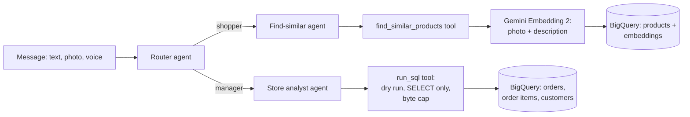

# Home Decor Agent

A multi-agent assistant for an online furniture and home decor store, built with Google's
**Agent Development Kit (ADK)**, **Gemini** and **BigQuery**.

- **Shoppers** send a photo of something they like and a voice note ("like this, but in
  navy and under 15k") and get matching products from a 13,900-item catalog.
- **Store managers** ask business questions in plain language ("why did rug returns go up
  after May?") and get answers computed with SQL over the store's sales data.
- A **routing agent** reads each message and hands it to the right specialist.

## Results

| What was measured | Result |
|---|---|
| Correct search filters from natural-language requests (30 requests x 3 runs, `gemini-3.5-flash`) | **100%** |
| Returned products within the requested price and size limits | **100%** |
| Same product found from a different photo of it, top 5 (210 queries) | **61.4%** |
| Top search result in the right product category | **76.2%** |

Details and the model comparison are in [Evaluation](#evaluation).

## Example

**Manager:** *Why did rug returns go up after May 2026?*

The router hands the question to the analyst, which breaks the returns down with SQL and answers:

> The increase is driven by **Stone & Beam** rugs: their return rate rose from **7.8%** to
> **26.1%** after May 2026, while other rug brands stayed flat (7.6% to 6.3%). 188 of the 215
> Stone & Beam returns cite **"colour differs from photo"**, and the brand's other categories
> are unaffected, which points to the product photos or a colour issue with a batch of rugs.

**Shopper:** *(photo of a black visitor chair, voice note: "I want something like this but
in navy blue")*

The router hands it to the shopping agent, which searches with the photo plus "navy" and
replies that the store has no navy version of that chair style. It offers the closest style
match (a black guest chair with a metal frame) and the closest colour match (a navy accent
chair), and says what each lacks.

## How it works



### Agents

All three are ADK `LlmAgent`s on `gemini-3.5-flash`, at low temperature for consistent
answers, with automatic retries when Vertex AI rate-limits.

- **Router** (`agent/router.py`): has the two specialists as `sub_agents` and uses ADK's
  agent transfer to pass each message to the right one.
- **Find-similar** (`agent/agent.py`, `agent/tools.py`): listens to the voice note, works
  out what the shopper wants, and turns only firm limits into filters. "Under 20k" and
  "fits a 1.8 m wall" become a price and a width limit, while "I'd like it in green" stays a
  preference in the search description. It then explains the best matches using only facts
  from the results.
- **Store analyst** (`agent/analyst.py`, `agent/sql_tools.py`): writes GoogleSQL against the
  sales tables, breaks numbers down to explain changes, and reports the period and the
  definitions it used. Every query is checked before it runs: one statement, confirmed as
  a `SELECT` by a BigQuery dry run, only the store's own dataset, at most 1 GB scanned
  (also enforced by `maximum_bytes_billed`), and at most 6 queries per question. BigQuery
  errors go back to the agent so it can fix its SQL.

### Multimodal search

Each catalog product is embedded once with **Gemini Embedding 2** (768 dimensions) from its
main image plus a short description (name, category, colour, material, style). A shopper's
photo plus the agent's description of what they want is embedded the same way, so "like this
photo, but in navy" becomes a single query vector.

One BigQuery query then ranks only the products that pass the filters (category, price,
colour, material, width, depth, height) by cosine similarity (`ML.DISTANCE`). Filter values
are always query parameters, never pasted into the SQL. Near-duplicate colour and size
variants are dropped from the top results.

### Catalog

Built from the Amazon Berkeley Objects dataset (`catalog/`): about 148,000 listings are
filtered to 13,921 English-named furniture and decor products in 21 categories. Broad product
types are sorted into categories by their category trail and name, and items the store would
not sell (tools, phone accessories, fabric swatches) are dropped. Sizes are converted to
centimetres, with the longest and shortest sides of each product's footprint computed so
that "width" means what a shopper means.

## Evaluation

Three automatic evaluations run against the live system (`evals/`).

**Search** (`evals/search_eval.py`). For 10 products per category, a *different* photo of
the same product (another angle, or the item in a room) is the query, with no text and no
filters.

| Metric | Result |
|---|---|
| Exact product in top 5 | 55.2% |
| Product or a colour/size variant in top 5 | 61.4% |
| Top result in the right category | 76.2% |

**Agent behaviour** (`evals/agent_eval.py`). 30 typed requests covering budgets ("25k",
"₹15,000", "fifteen hundred rupees", ranges), sizes in metres, feet and cm, preferences versus
requirements, vague words that must not become filters ("cheap", "small"), and Hinglish. Each
case lists the filters a correct agent sets and the ones it must not set, and every request
runs 3 times.

The first version, on `gemini-3.5-flash-lite`, set exactly the right filters in 71.1% of runs.
Normalising category names in the tool and tightening the instructions and tool descriptions
brought that to 94.4%. Comparing models on the same set:

| Metric | gemini-3.5-flash-lite | gemini-3.5-flash |
|---|---|---|
| Filters exactly right | 94.4% | **100%** |
| Requests right in all 3 runs | 90.0% | **100%** |
| Same filters in every run | 73.3% | **86.7%** |
| Returned products within the limits | 100% | **100%** |
| One search per request | 97.8% | **100%** |

The agents use `gemini-3.5-flash`. It costs about 5 times more per request, but it was the
only model that reliably told a requirement ("only real leather") from a preference.

**Analyst and routing** (`evals/analytics_eval.py`). 20 business questions, each checked
against a reference SQL answer, and 10 shopper and manager messages checked for where the
router sends them.

## Tech stack

Google ADK · Gemini 3.5 Flash (text, image and audio input) · Gemini Embedding 2 ·
Vertex AI · BigQuery · Python 3.12 and 3.13 (tested) · pytest (195 tests, no network needed)

## Running it

Everything runs from Google Cloud Shell, which already has Python, `gcloud` and credentials.
Replace `YOUR_PROJECT_ID` with your project.

```bash
git clone https://github.com/divyanshkulshrestha23/home-decor-agent.git
cd home-decor-agent
pip install -r requirements.txt
gcloud services enable bigquery.googleapis.com aiplatform.googleapis.com
export GOOGLE_CLOUD_PROJECT=YOUR_PROJECT_ID
```

**1. Build the catalog and load it into BigQuery**

```bash
curl -O https://amazon-berkeley-objects.s3.amazonaws.com/archives/abo-listings.tar
curl -O https://amazon-berkeley-objects.s3.amazonaws.com/images/metadata/images.csv.gz
python3 -m catalog.prepare --listings abo-listings.tar --images-metadata images.csv.gz
python3 -m catalog.load_bigquery --project YOUR_PROJECT_ID
```

**2. Embed the product images** (one-time; streams the image archive and keeps only the
catalog's images)

```bash
curl -s https://amazon-berkeley-objects.s3.amazonaws.com/archives/abo-images-small.tar \
  | python3 -m catalog.fetch_images
python3 -m catalog.embed_images --project YOUR_PROJECT_ID
python3 -m catalog.embed_images --project YOUR_PROJECT_ID --load
```

**3. Generate and load the sales data**

```bash
python3 -m sales.generate
python3 -m sales.load --project YOUR_PROJECT_ID
```

**4. Talk to the assistant**

```bash
python3 -m agent.cli --text "Why did rug returns go up after May 2026?"
python3 -m agent.cli --text "a jute rug for a small bedroom, under 5000"
python3 -m agent.cli --image chair.jpg --audio note.m4a
```

Each run prints the reply and every tool call, including the agent transfer, the SQL it
ran, and the products the search returned.

**5. Run the evaluations**

```bash
python3 -m evals.agent_eval --project YOUR_PROJECT_ID
python3 -m evals.analytics_eval --project YOUR_PROJECT_ID
python3 -m evals.search_eval prepare --images-metadata images.csv.gz
curl -s https://amazon-berkeley-objects.s3.amazonaws.com/archives/abo-images-small.tar \
  | python3 -m catalog.fetch_images --paths-file evals/data/query_paths.txt --out data/eval_images
python3 -m evals.search_eval run --project YOUR_PROJECT_ID
```

## Project layout

```
agent/      router, find-similar and analyst agents; search; guarded SQL tools; CLI
catalog/    dataset filtering, categories, pricing, image extraction, embeddings, loading
sales/      synthetic sales generator and loader
evals/      search, agent-behaviour and analytics evaluations, with their test cases
tests/      unit tests with fake models and fake BigQuery (no network)
```

## Data

Product data, images and sizes come from the
[Amazon Berkeley Objects](https://amazon-berkeley-objects.s3.amazonaws.com/index.html)
dataset (CC BY-NC 4.0); see [DATA_NOTICE.md](DATA_NOTICE.md). The dataset has no prices or
sales, so prices (`catalog/pricing.py`) and the sales history (`sales/generate.py`, about
55,000 orders from January 2025 to October 2026) are generated, with fixed seeds so they are
reproducible.

## Tests

```bash
pip install -r requirements-dev.txt
python3 -m pytest
```
